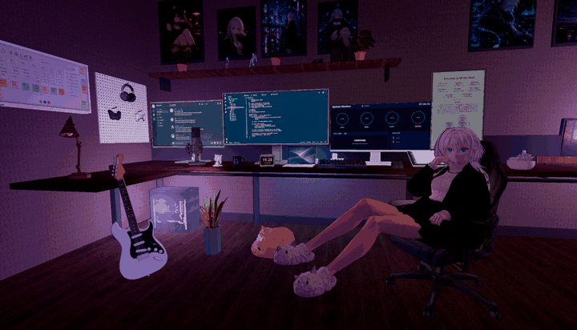

# Girl Desk Wallpaper

用 [Infinite Canvas](https://github.com/sizhouLiu/infinite-canvas) + Tripo 生成 3D 素材，在 Blender 里搭场景，再一条命令打包成 Wallpaper Engine 可交互网页壁纸。



## 功能

- 三渲二风格：卡通材质、深度勾线、泛光、AgX 色调映射（three.js 0.170）
- 可点击交互：台灯、显示器开关、实时时钟、昼夜切换、窗帘/百叶窗、书架（打开书的免费版或配套代码）、猫（呼吸 + 呼噜/猫叫）、吉他
- 系统监控屏：本地辅助程序提供 CPU / GPU / 内存 / 网络数据
- 多机位、帧率、分辨率、曝光、描边等参数可在 Wallpaper Engine 设置面板里调
- 一键流程：Blender 导出 → 贴图 WebP + meshopt 压缩（351 MB → 24 MB）→ Vite 构建 → 打包 zip → 截图自检
- 换场景只改 `wallpaper.config.json`，仓库内附带咖啡馆（`scenes/cafe`）和雪桥（`scenes/snow-bridge`）两个示例场景

## 快速开始

需要 Node.js 18+、Chrome（截图自检用），重新导出场景时还需要 Blender 5.x 和 Python + Pillow。

```bash
npm install
npm run dev                                   # 开发预览 http://localhost:5199
npm run pipeline -- --skip-export --check     # 用仓库里已导出的 room.glb 构建壁纸
```

构建完成后在 Wallpaper Engine 里选「打开壁纸 → 从文件打开 → `wallpaper/index.html`」。

## 常用命令

```bash
npm run pipeline -- --check                   # 完整流程，含 Blender 无界面导出
npm run pipeline -- --rebake --check          # 重新烘焙人物贴图
npm run pipeline -- --config scenes/cafe/wallpaper.config.json --check   # 构建其他场景
npm run preview                               # 预览所有已构建壁纸 http://localhost:4173
helper\start-stats.bat                        # 启动系统监控辅助程序（只监听 127.0.0.1）
```

`npm run pipeline` 还支持 `--config <文件>`、`--blend <文件>`、`--blender <exe>`，Blender 路径也可用环境变量 `BLENDER` 指定。每步结果写到 `work/pipeline/report.json`。

`.blend` 工程文件不在仓库里，`--check` 不带 `--skip-export` 时需要用 `--blend` 指向你自己的场景。

## 目录

| 路径 | 说明 |
| --- | --- |
| `src/` | 网页运行时：渲染、卡通材质、三渲二后处理、交互、声音、设置 |
| `pipeline/` | 一键流程、Blender 导出脚本、本地预览服务 |
| `tools/` | 贴图压缩、几何优化、截图测试 |
| `public/` | 已导出的场景资源与 Wallpaper Engine `project.json` |
| `scenes/` | 其他示例场景的配置与资源 |
| `helper/` | 系统监控辅助程序 |
| `docs/pipeline-report.md` | 从 3D 模型到壁纸的完整实现流程和踩坑记录 |

## 配合 Infinite Canvas

画布仓库提供「壁纸预览」节点插件和 `wallpaper-pipeline` Skill：在画布里直接预览、点击交互已构建的壁纸，并让侧边栏 Agent 一句话跑完构建流程。

## 素材协议

猫叫录音来自 Wikimedia Commons，均为 CC0，详见 `public/sounds/CREDITS.txt`。呼噜声和吉他声由代码合成。
